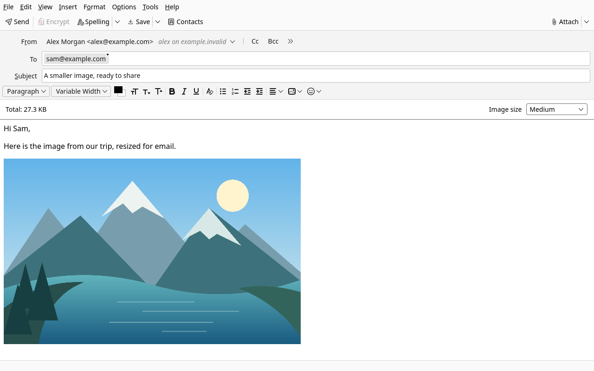

# Image Resizer for Thunderbird


An image size selector directly above the message body. Works with **inline images** inserted through **Insert → Image**, pasted or dropped into the message, and with **image attachments**. All add-on text is English.

The bar appears when the message contains eligible images. Choose a size on the right; **Total** on the left shows the combined size of the inline images and image attachments. Both the visible inline images and the attachment contents change immediately.



| Choice | Maximum long edge | JPEG / WebP encoding quality |
| --- | ---: | ---: |
| Original size | Original dimensions | Original bytes |
| Small | 320 px | 80% |
| Medium | 640 px | 85% |
| Large | 1280 px | 90% |

Images keep their aspect ratio and are never enlarged. PNG transparency and JPEG orientation are preserved. PNG files remain PNG; JPEG and WebP keep their format. If resizing would increase the file size, the original is kept. Animations and unsupported formats stay unchanged, with a note in the bar. Newly inserted images inherit the current choice.

Switching back to **Original size** restores the original bytes and the original inline image dimensions while the compose window remains open. Original files on disk are never overwritten. Other attachments are not modified.

## Large-image warning

When the combined image size exceeds **10 MB**, an inline warning suggests choosing a smaller size. Clicking Send while still over the limit opens this confirmation:

> **Large images**
>
> The images in this email total {size}, which exceeds 10 MB. Go back to choose a smaller image size, or continue sending.

Buttons: **Go back** and **Continue sending**. Go back is the default; closing the confirmation also cancels sending. Continue sending preserves the selected size. There is no send confirmation at or below 10 MB.

Sizes use Thunderbird's 1024-based convention. Total is the sum of image file bytes before MIME/base64 encoding; it excludes the message text, non-image attachments, and web-hosted images. It is not the final email size.

## Install and build

The build has no npm dependencies. It requires Node.js 20+ and Python 3.

```sh
npm run check
```

This checks JavaScript syntax, runs the tests, and produces `dist/image-resizer-1.0.2.xpi` and `dist/image-resizer-1.0.2-source.zip`. To build only:

```sh
npm run build
```

In Thunderbird, open **Add-ons and Themes → gear menu → Install Add-on From File**, then select the XPI. No restart is normally needed. The manifest permits Thunderbird 128–160; live testing was performed with Thunderbird 160 on Linux.

This add-on uses a small Thunderbird Experiment API to place the controls in the native compose window and access inline images. Thunderbird therefore displays its full-access permission prompt. Image processing happens locally; the add-on has no analytics, external services, or network endpoints. It does not request the permission to send messages on its own.

## Scope and behavior

- Static JPEG, PNG and WebP images are resized. GIF, APNG, animated WebP, SVG, HEIC and other unsupported formats remain original.
- The add-on observes image insertion, removal and source changes in the editor. Normal text editing does not trigger image processing.
- Web-hosted images are not downloaded. Thunderbird's blocked-content restrictions are respected; blocked file and message-part images are not read by the add-on.
- The original-image cache belongs to the open compose window. Saved drafts contain the currently selected image bytes. After closing and reopening a draft, or restarting/disabling the add-on, its saved images become the originals; recovering earlier full-resolution images requires reattaching them from disk.
- Resized images are re-encoded and may lose EXIF and other metadata. Original size preserves everything.
- If preparation or replacement fails, the add-on displays an inline error and cancels a send that still cannot be prepared. Original images are retained for recovery while the compose window is open.

## Validation

`npm test` covers proportions, no upscaling, image/animation detection, original restoration, mixed inline/attachment totals, live selection, new and removed images, rapid changes, partial failures and rollback recovery, compose-window closure, and the 10 MB send confirmation.

Live Marionette testing in Thunderbird additionally checked:

- All four sizes in the actual native selectbox, including an inline-only message.
- Original image bytes and inline dimensions restored after switching between sizes.
- Transparent PNGs, EXIF-rotated JPEGs, APNG and animated WebP.
- The warning above 10 MB, Go back cancelling delivery, and the warning clearing after reduction.
- Delivery of a message containing an inline image and an image attachment, verifying the received MIME parts for actual dimensions and byte sizes.

Local test results are excluded from both distribution archives and the public repository.

## Implementation

- `src/images.js`: format/animation detection and local canvas resizing.
- `src/controller.js`: per-compose originals, cached variants, sequential updates, rollback and send checks.
- `src/api/imageResizeUI/`: native compose bar, editor observation, inline image access and large-image confirmation.
- `src/background.js`: event wiring.
- `scripts/build.py`: deterministic XPI and source packaging with an explicit public-file selection.
- `scripts/render_icons.py`: regenerate PNG icon sizes from the editable SVG using `rsvg-convert` (only needed when changing the icon).

Technical references: [Thunderbird compose API](https://webextension-api.thunderbird.net/en/mv2/compose.html) and [Thunderbird Experiments](https://developer.thunderbird.net/add-ons/mailextensions/experiments).

## Distribution

Use the XPI for submission to [Thunderbird Add-ons](https://addons.thunderbird.net/). The source ZIP contains the matching readable source and build instructions. [Listing text and reviewer notes](distribution/listing.md) and a [privacy statement](PRIVACY.md) are included.

The add-on has a neutral UUID identifier, with no personal author, email address, or machine-specific configuration. Keep the identifier unchanged after publication so future releases update the same add-on. This identifier differs from earlier development builds; disable or remove a development build before installing the public package to avoid duplicate controls.

Licensed under the [MIT License](LICENSE). The license is included in generated XPI and source packages.
